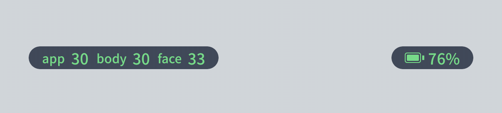

程序左上角会显示运行帧率，以及身体和脸部的捕捉帧率。这几项数字能稳定在 25 fps 以上，就说明可以稳定动捕。如果帧率偏低或忽高忽低，在安卓手机上往往是系统的性能限制造成的，可以按下面的方法调整。

## 在安卓手机上让 SAYA 发挥全部性能

为了省电和控制温度，安卓系统默认会限制应用的处理器频率和后台运行。动作捕捉需要长时间满负荷计算，一旦受到限制，帧率就会明显下降，全身捕捉时尤其明显。完成下面两项设置后，SAYA 就能获得更充足的性能。

### 一、把 SAYA 加入游戏模式

很多手机自带游戏模式，可以解除对处理器频率的限制。把 SAYA 添加进去，并选择性能优先的选项。

| 品牌 | 设置方法 |
|---|---|
| 小米 / Redmi（HyperOS） | 在设置中搜索**游戏加速**，或在**手机管家**中找到**游戏加速**。添加 Dollars SAYA，再把性能选项设为**性能模式**。 |
| 三星 | 打开**游戏中心**（Game Launcher），添加 Dollars SAYA，在游戏加速器中把性能设为优先。 |
| OPPO / 一加 / realme | 打开**游戏助手**或**游戏空间**，添加 Dollars SAYA，选择高性能模式。 |
| vivo / iQOO | 打开**游戏魔盒**或**游戏空间**，添加 Dollars SAYA，选择性能模式。 |
| 荣耀 / 华为 | 打开**游戏中心**或**游戏空间**，添加 Dollars SAYA，开启性能模式。 |
| Google Pixel 等原生系统 | 没有这类设置，可直接跳过这一步。 |

:::tip 提示

不同系统版本的菜单名称可能有所不同。如果找不到，可以在系统设置中搜索**游戏**。

:::

### 二、将电池设为无限制

游戏模式解决的是处理器频率的问题，而电池设置决定了系统是否会在后台限制 SAYA。把电池设为**无限制**，可以防止系统在长时间运行或切到后台时限制甚至关闭 SAYA。

1. 长按 SAYA 图标，点击**应用信息**。
2. 进入**电池**、**耗电管理**或**省电策略**（不同手机叫法不同）。
3. 选择**无限制**或**不受限制**。如果有**允许后台运行**，也请一并开启。

设置完成后，回到 SAYA 查看左上角的帧率，确认是否已稳定在 25 fps 以上。

### 注意事项

- 解除限制后，手机发热和耗电都会明显增加，而温度过高时系统仍会自动降频，帧率也会随之下降。因此长时间使用时建议连接电源、取下厚手机壳，并避免阳光直射。直播或长时间录制时，可以搭配手机散热背夹。
- 如果帧率仍然不稳定，可以先让手机冷却几分钟再使用。
