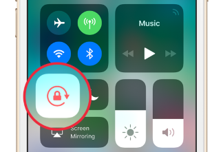
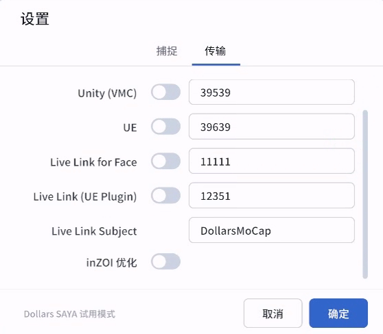

---
sidebar_position: 10
title: 开始使用
---	

# 开始使用

## 设备放置

为获得最佳的捕捉效果，请根据您的使用场景摆放设备，并保持设备尽量垂直，避免前倾或后仰。

### 半身捕捉

- **放置位置**  
  将设备放置在身体前方，高度尽量与面部齐平。

- **取景范围**  
  当您双手处于休息状态时（比如双手下垂，或者您操作鼠标或者键盘时），确保它们处于镜头之外。  
  当您举起双手时，双手应完全进入镜头范围内。

  若空间允许，可稍微后退，以获得更完整的捕捉范围。

### 全身捕捉

- **放置位置**  
  将设备放置在身体正前方，高度大约在腰部，并与身体保持足够的距离。

- **取景范围**  
  从头到脚都应完整处于画面中，活动过程中双脚也不要离开画面。  
  请预留足够的活动空间，避免走出镜头范围。

### 朝向调整

SAYA 默认以向左横屏启动。若需以其他朝向捕捉，请在控制中心关闭屏幕旋转锁定，再将设备旋转到所需角度。

## 拍摄环境

### 光线条件

建议在明亮、均匀的光线下进行拍摄，确保面部、手部和身体轮廓清晰可见。避免强烈的背光、过暗的环境或明暗变化频繁的光线，以减少识别误差。

### 背景布置

尽量选择简洁、整洁的背景，避免背景中出现与您动作相似的物体或其他移动的人物。建议让身体与背景在颜色上保持明显区别，以帮助系统更准确地识别身体和手部关键点。

### 服装选择

建议穿着与背景颜色有明显区别的衣物，避免上衣或裤子与背景颜色过于接近。尽量避免过于宽松、容易遮挡身体轮廓或具有强烈反光效果的衣物。

## 连接电脑

完成设备放置后，请按照以下步骤连接电脑。

1. 打开 Dollars SAYA 应用，进入主界面的设置页面。  
2. 在“目标 IP”输入框中填写您的电脑局域网 IP。  
3. 确认输入无误后，点击“保存”。  

> **提示**  
> 若使用 USB 连接电脑，系统可能会为设备分配新的 IP。此时，请重新在设置中填写新的 IP 地址。

## 流送至 PC 端软件

Dollars SAYA 可以将捕捉到的数据实时流送至电脑端程序或 VTuber 软件。

在 SAYA 的设置页面中，开启相应协议的开关，即可将捕捉数据实时传输至电脑端软件。

- **VMC**：用于 VTuber、虚拟主播或 Unity 接收。  
- **UE**：用于以道乐师 OSC 插件驱动 Unreal Engine 角色。
- **Live Link for Face**：用于 Unreal Engine 实时驱动面捕。  
- **Live Link(UE Plugin)**：用于以道乐师 Live Link 插件驱动 Unreal Engine 角色。

## 使用技巧

### 设备端优化建议

**提升网络稳定性**  
若您觉得无线网络延迟较高或连接不稳定，可使用有线网口转换器（Lightning/USB-C 转 RJ45），将设备直接连接至路由器。  
这种方式可显著降低延迟并避免 Wi-Fi 波动。

**USB 模式使用**  
您也可以使用 USB 数据线直接连接电脑。  
在这种模式下，建议开启飞行模式，以防止来电或通知中断直播或录制。

**注意机器温度**  
设备长时间运行可能会发热。我们已进行了多种优化来降低发热，但在持续使用时温度仍可能升高。  
我们建议  
* 使用一些降温设备，如小型风扇。
* 提前进行测试，且测试时间应长于预计的直播时长，以了解设备在长时间运行时的温度表现。

