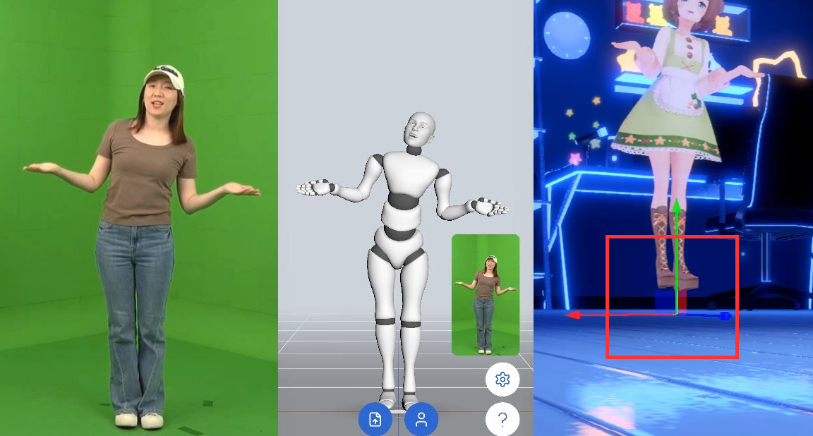
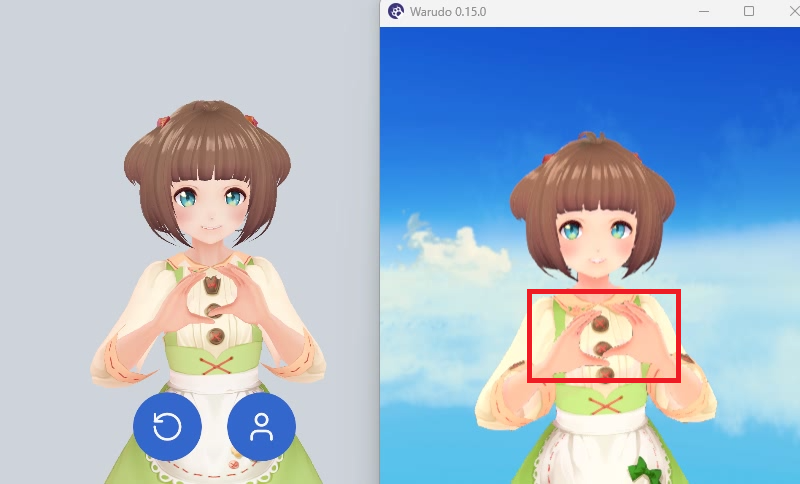

# 载入 VRM

## 载入 VRM 的作用

SAYA 默认根据道乐师内置模型的体型进行动作解算。如果您使用的角色与内置模型在肩宽、臂长等身体比例上存在较大差异，就可能出现动作偏差。例如，在双手合十等需要精确对位的动作中，双手可能无法准确贴合，甚至出现穿模。

此外，如果角色的腰部高度与内置模型存在较大差异，也可能导致脚部位置出现偏差，造成脚部穿地或悬空。

载入您的 VRM 模型后，SAYA 就能根据该模型的骨骼比例进行动作解算，让动作更贴合角色自身的体型，减少双手错位、穿模以及脚部位置异常等问题。

## 操作流程

1. 将角色的 VRM 文件传输到您的设备，可使用 AirDrop、云盘或数据线等方式。
2. 在 SAYA 中点击下方按钮，在弹出的对话框中选择您的 VRM 即可。

载入完成后，该 VRM 会在 SAYA 每次启动时自动加载。

:::info 注意

载入 VRM 只影响 Unity(VMC) 传输协议的输出，其他协议不受影响。

:::
