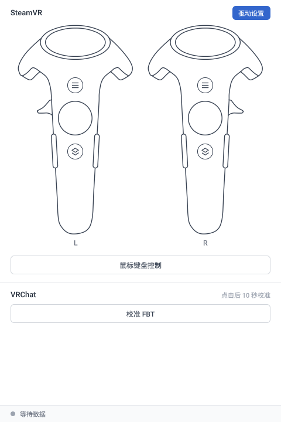
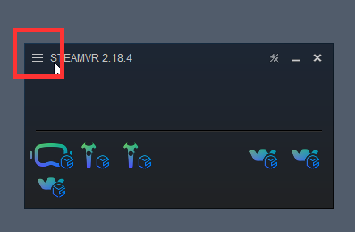
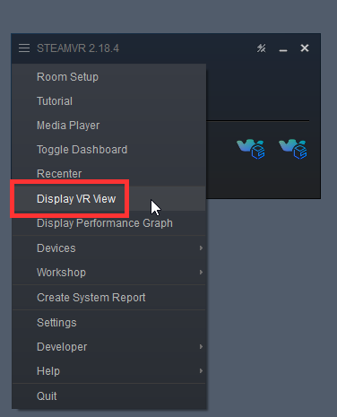

# 手柄与鼠标键盘控制

## 手柄按键

Bridge 主界面上方显示两只手柄：左侧 L 对应左手，右侧 R 对应右手。用鼠标按住手柄图上的按键，即可模拟按下对应手柄上的按键，松开鼠标则松开按键。

- 可操作的按键包括菜单按钮、系统按钮、扳机、触控板和握持按钮。
- 触控板：按下的位置对应手指在触控板上的位置，按住并拖动鼠标可移动该位置。
- 按下的键会以蓝色显示。

## 查看按键

在 SteamVR 的 VR View 中，可以看到虚拟手柄以及按键的效果。

1. 点击 SteamVR 窗口左上角的 ☰ 菜单按钮。

   

2. 勾选 **Display VR View**。

   

打开后，VR View 窗口中会显示虚拟手柄。在 Bridge 中按下按键时，可以在其中看到对应的效果。

### 扳机

<video controls width="100%">
  <source src="/steamvr-trigger.mp4"/>
</video>

### 触控板

<video controls width="100%">
  <source src="/steamvr-trackpad.mp4"/>
</video>

### 系统按钮

<video controls width="100%">
  <source src="/steamvr-system-button.mp4"/>
</video>

## 鼠标键盘控制

为了简化操作，Bridge 提供了鼠标键盘控制。点击主界面的「鼠标键盘控制」后，即可直接用鼠标和键盘操作头显与手柄。

| 操作 | 说明 |
| --- | --- |
| 移动鼠标 | 转动视角。 |
| 鼠标左键 | 按下扳机。 |
| Esc | 退出鼠标键盘控制，头显和双手恢复为动捕控制。 |
