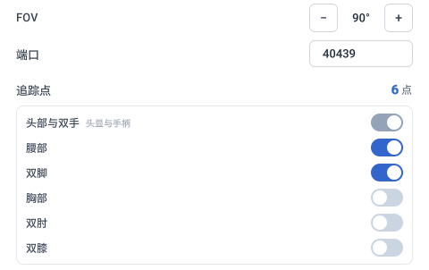
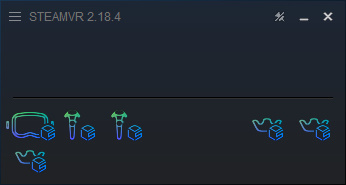
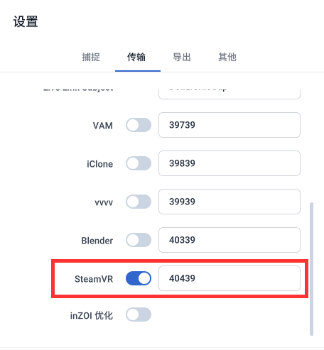
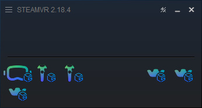

# SteamVR

:::info 注意
Dollars MONO 和 Dollars SAYA 自 v.261110 起支持。

以下驱动安装步骤适用于未安装实体头显的情况。如果电脑已安装实体头显，请参考 SteamVR 文档了解如何安装两套 VR 系统。
:::

使用前，请先通过 Steam 安装 SteamVR，并在[道乐师官网](https://www.sunnyview.tech/download#plugins)下载 **道乐师 SteamVR 套件**（程序名为 DollarsMoCapSteamVRBridge，以下简称 Bridge）。

## 安装驱动

1. 将 Bridge 的文件夹放到一个固定的位置。驱动会从 Bridge 所在的目录加载，安装后如果移动了文件夹，需要重新安装驱动。
2. 关闭 SteamVR。
3. 打开 Bridge，点击右上角的「驱动设置」。
4. 根据需要修改设置，点击「安装」。

| 设置 | 说明 |
| --- | --- |
| FOV | 虚拟头显的垂直视场角，默认值为 90°。 |
| 端口 | 接收动捕数据所用的端口，默认为 40439，须与 MONO 或 SAYA 中 SteamVR 的端口一致。 |
| 追踪点 | 头部和双手始终启用，其他部位可按需勾选。默认启用 6 点追踪（头部、双手、腰部和双脚）。建议先从此配置开始，熟悉使用后再逐步增加追踪点。右侧会显示追踪点总数。 |

安装完成后启动 SteamVR，即可在 SteamVR 窗口中看到道乐师的虚拟头显和追踪器图标。此时还没有收到动捕数据，图标只显示轮廓。

## 道乐师产品端设置

在设置的「传输」页中启用 SteamVR，并确保端口与 Bridge 驱动设置中的端口一致（默认为 40439）。

开始传输后，SteamVR 窗口中的头显、手柄和追踪器图标会变为实心，表示已收到动捕数据。

- 如果道乐师与 SteamVR 不在同一台电脑上，请将道乐师的目标 IP 设置为运行 SteamVR 的电脑的 IP 地址。Bridge 必须与 SteamVR 在同一台电脑上运行。
- Bridge 收到动捕数据后，窗口底部会显示「正在接收」。
- 发送给 SteamVR 的始终是实际的左右手数据，不受镜像开关影响。

## 卸载

关闭 SteamVR 后，在驱动设置页点击「卸载」。Bridge 会移除该驱动的注册信息，以及由该驱动写入的房间和追踪器设置。其他驱动和设置不受影响。
