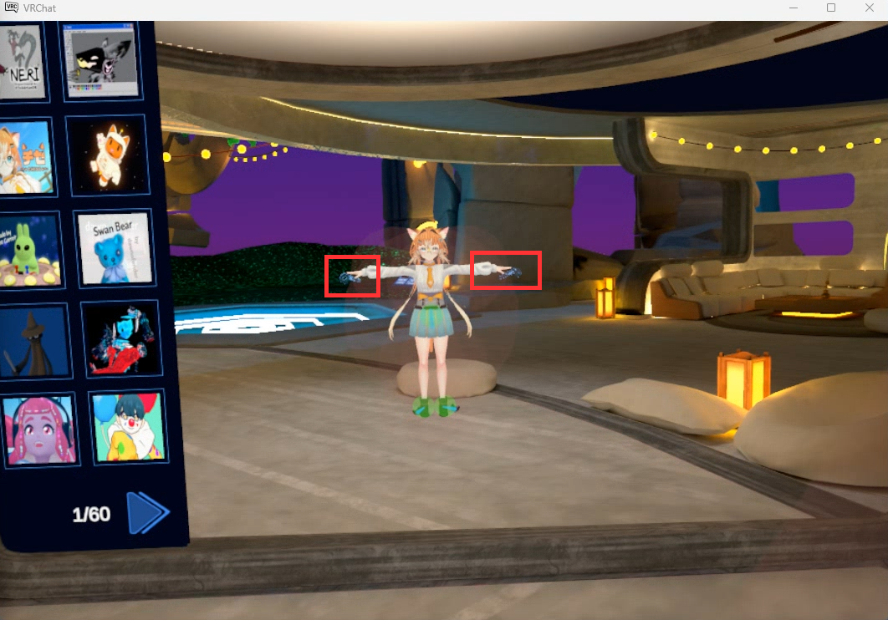
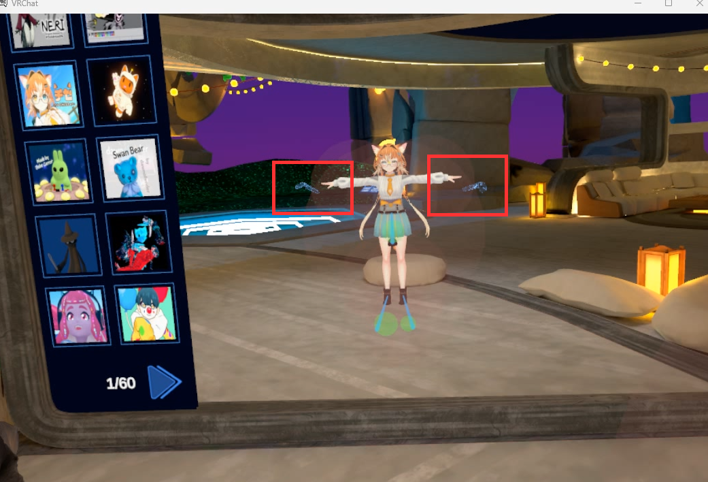

# 全身校准

## 首次设置

第一次校准前，请在主菜单的 **Tracking & IK** 设置中，将 **User Real Height** 设为 5' 11"（1.80 m）。这是道乐师程序中 Avatar 的身高，设置一致后，VRChat 中的 Avatar 可以更好的还原动作。

此项只需设置一次，之后校准时无需重复设置。

<video controls width="100%">
  <source src="/vrchat-fbt-real-height.mp4"/>
</video>

## 校准步骤

1. 在道乐师产品中完成动捕校准。
2. 在 Bridge 中点击「鼠标键盘控制」，按 Q 打开快捷菜单，在 VRChat 快捷菜单中点击 **Calibrate**。
3. 按 Esc 退出鼠标键盘控制，头部和双手恢复由动捕数据控制。然后在 Bridge 中点击「校准 FBT」，在 10 秒倒计时内站直身体，双手向两侧平举。
4. 倒计时结束后，Bridge 会自动同时扣下左右手柄的扳机，完成 VRChat 全身校准。

### 1. 道乐师中的动捕校准，这里以 MONO 为例

<video controls width="100%">
  <source src="/vrchat-fbt-mocap-calibration.mp4"/>
</video>

### 2. 打开快捷菜单，点击 Calibrate

<video controls width="100%">
  <source src="/vrchat-fbt-calibrate.mp4"/>
</video>

### 3. 点击「校准 FBT」并平举双手

<video controls width="100%">
  <source src="/vrchat-fbt-countdown.mp4"/>
</video>

### 4. 完成全身校准

<video controls width="100%">
  <source src="/vrchat-fbt-done.mp4"/>
</video>

## 调整手臂比例

校准时，VRChat 中显示的 VR 控制器应与 Avatar 的双手位置大致重合。

如果控制器明显位于 Avatar 双手的外侧，

请在主菜单的 **Tracking & IK** 设置中调大 **Arm vs Height Ratio**，

<video controls width="100%">
  <source src="/vrchat-fbt-arm-ratio.mp4"/>
</video>

然后重新校准。

反之，如果控制器落在 Avatar 的手臂内侧，则适当调小 **Arm vs Height Ratio**。
