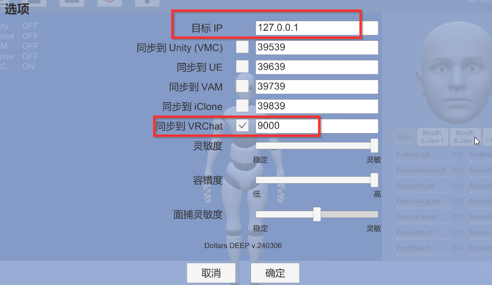
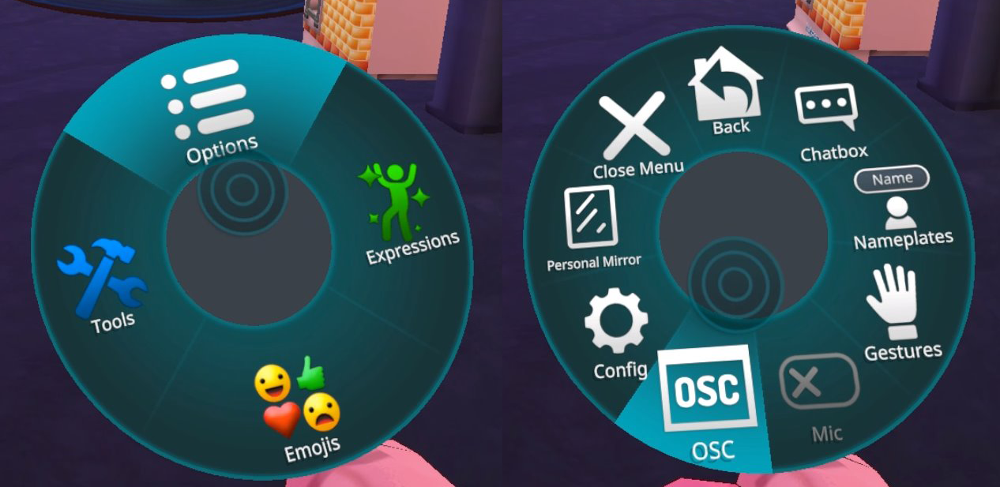
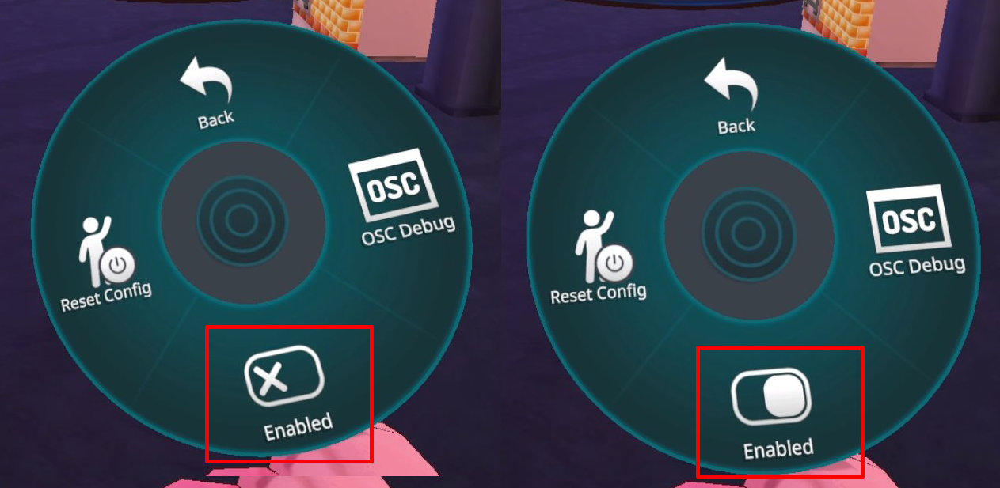
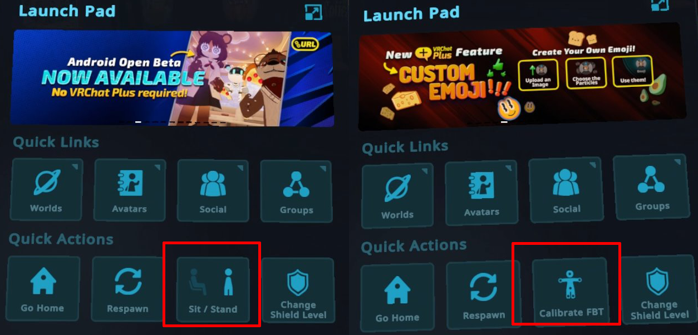
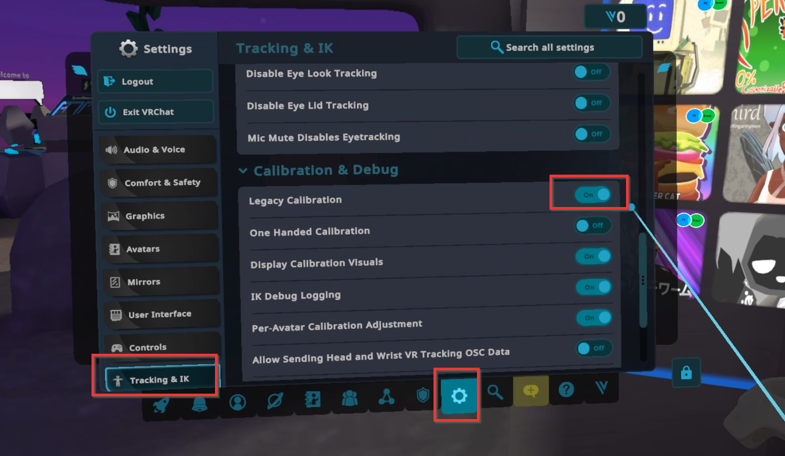
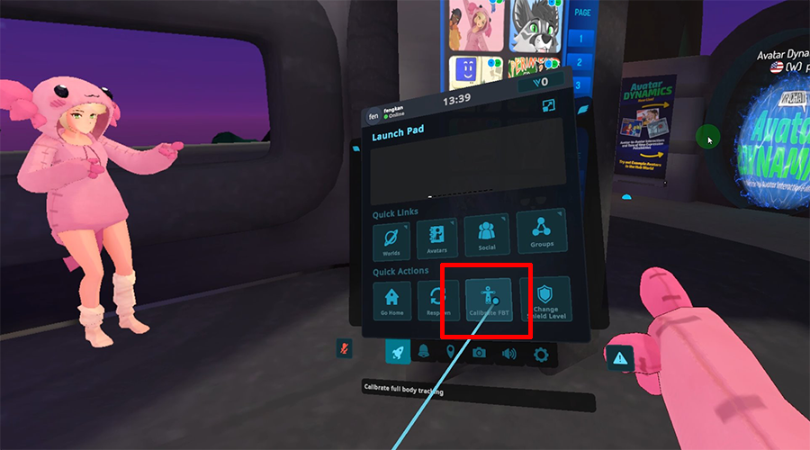
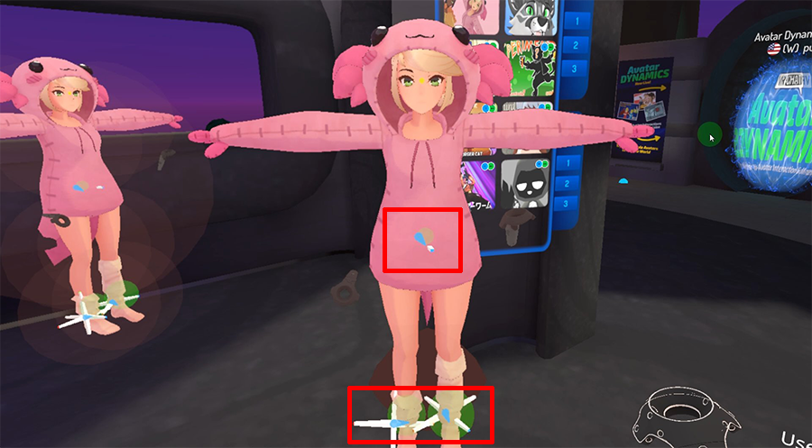

# VRChat 全身动捕

:::info 注意
以下道乐师产品支持 VRChat 全身动捕：

- Dollars DEEP（自 v.240306 起）
:::

## 准备

### 道乐师产品端

请启用 VRChat 同步；如有需要，也可以修改 IP 地址和端口。

### VRChat 端

#### 激活 OSC

打开 Action Menu，然后依次选择 Options > OSC，进入 OSC 设置。

点击 Enabled，启用 OSC。

不同控制器打开 Action Menu 的方式可能不同，详情请参阅 VRChat 文档：

https://docs.vrchat.com/docs/action-menu

启用 OSC 后，Quick Menu 中的「Sit/Stand」选项会替换为「Calibrate FBT」。

#### 切换动捕模式

此外，建议在 Settings 中将 Legacy Calibration 设为 On。

至此，准备工作完成。

## 校准

在 Dollars DEEP 中完成校准后，点击 Quick Menu 中的「Calibrate FBT」选项。

此时，腰部和腿部位置应会显示追踪器。

然后向两侧伸展双手，同时扣动左右手柄的扳机，即可完成校准。
